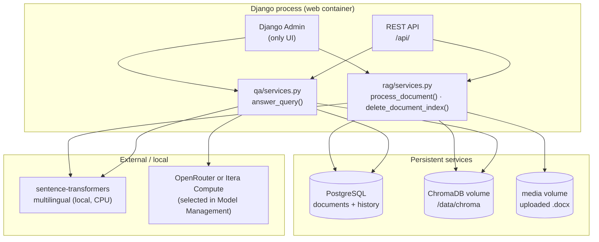
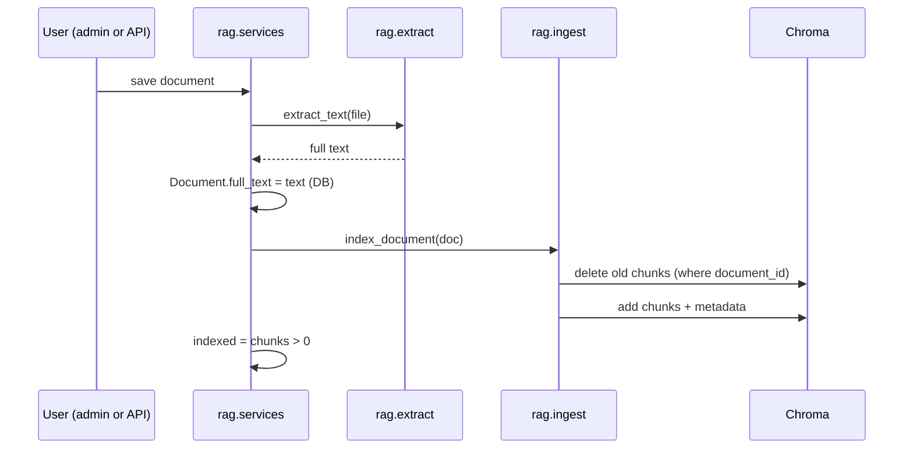
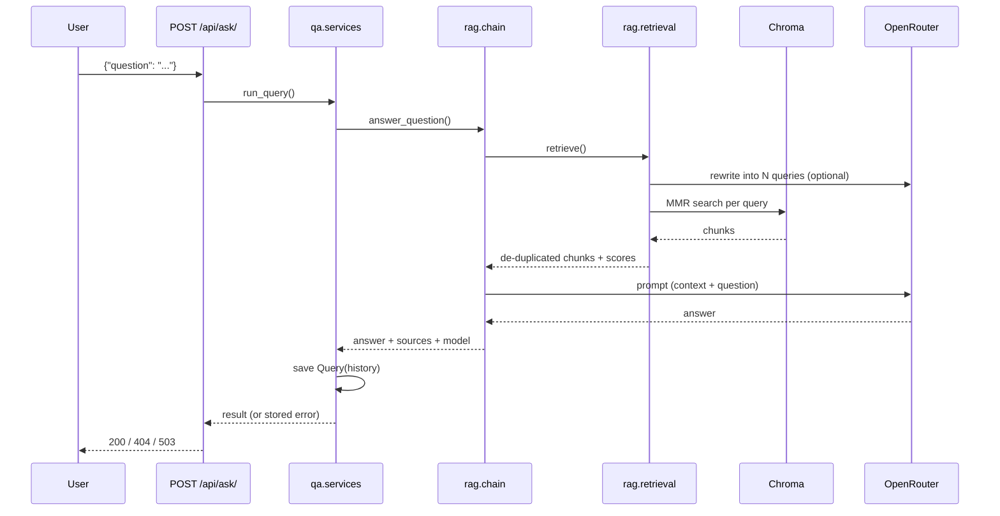

# Architecture

## Big picture

Everything runs in one `web` container; PostgreSQL and the two data directories
are separate containers/volumes. There is no Celery or queue: indexing happens
synchronously on save, which keeps the project small and easy to explain.

## Why ChromaDB is embedded, not a Compose service

Chroma is used as a **library**, not a server. `rag/vectorstore.py` opens a
`langchain_chroma.Chroma` collection with
`persist_directory=settings.CHROMA_DIR` (`/data/chroma`, the `chroma_data`
volume). No `chromadb` HTTP service, port or container is involved.

Why this is the right shape here:

- **One writer.** Only the Django process writes chunks (upload, re-index,
  delete). There is no second client that needs a shared server.
- **Small corpus.** The index is a few thousand chunks; in-process access is
  faster than an HTTP round trip and needs no connection pool.
- **Fewer moving parts.** No extra image, port, healthcheck, auth token or
  backup target. A `docker compose up` starts one application service plus the
  database.
- **Durability is unchanged.** The embedded client persists to the named
  volume, so data survives container rebuilds exactly like the Postgres volume.

The trade-off: Chroma cannot be scaled to several web replicas writing at the
same time, because the embedded store assumes one process owns the directory.
If that becomes necessary, run Chroma in server mode (or move to a managed
vector database) and keep `get_vectorstore()` as the single seam; the rest of
the pipeline does not need to change.

The library changelog still lists server-side authorization advisories for
Chroma. They apply to the HTTP server (`/api/v2/...`) with tenants/collections;
this project never exposes that server, only the local persistent client.

## Why the logic lives in `rag/`

- `documents/admin.py` and `documents/views.py` only call
  `process_document()` / `delete_document_index()`.
- `qa/admin.py` and `qa/views.py` only call `answer_query()` / `run_query()`.
- Result: admin and API behave identically, and the RAG code can be tested
  without HTTP or admin.

## Request flow for a question

## Runtime configuration

| Concern | Where |
|---|---|
| Django settings | `config/settings.py` (all env vars) |
| Compose services, volumes | `docker-compose.yml` |
| Image build, Python 3.12 | `Dockerfile` |
| Migrate + admin bootstrap | `entrypoint.sh` |
| API schema | drf-spectacular at `/api/schema/` |

## Data storage

| Data | Store | Survives `docker compose down`? |
|---|---|---|
| Documents metadata + full text | PostgreSQL volume | yes |
| Question/answer history | PostgreSQL volume | yes |
| Uploaded `.docx` files | `media` volume | yes |
| Chunks + embeddings | `chroma_data` volume | yes |

`docker compose down -v` removes all three volumes.
